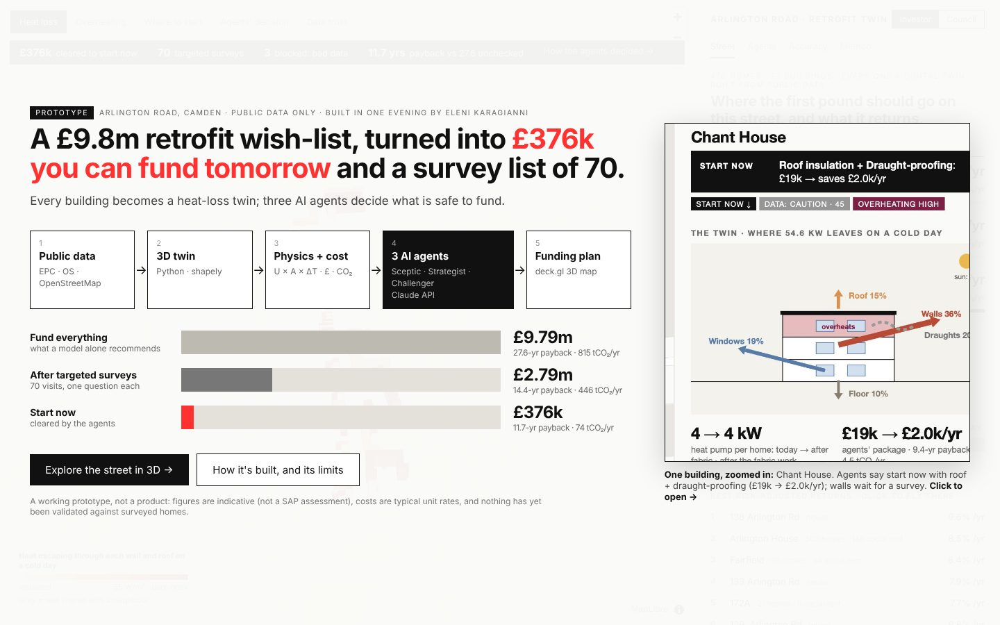
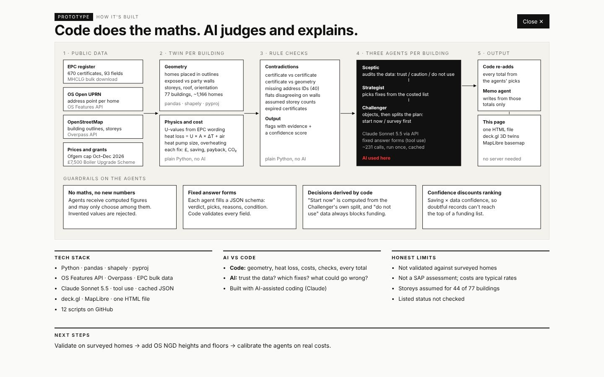

# Arlington Road retrofit twin

**A prototype: one Camden street turned into heat-loss digital twins, with three AI agents deciding what is safe to fund now and what needs a survey first.**

Built from public data only by Eleni Karagianni, November 2026.

### ▶ [Open the live demo](https://elenikaragianniarch-lab.github.io/arlington-road-twin/)

*Interactive 3D street, one page, runs in the browser. Click any building to see its twin, costed measures and the agents' debate.*



## The result in one line

A £9.8m "insulate everything" wish-list for 77 buildings (~1,166 homes) becomes:

| | Cost | Saves / yr | Payback | CO₂ saved / yr |
|---|---|---|---|---|
| **Start now** (cleared by the agents) | £376k | £32k | 11.7 yrs | 74 t |
| **After 70 targeted surveys** | £2.79m | £194k | 14.4 yrs | 446 t |
| Fund everything, unchecked | £9.79m | £355k | 27.6 yrs | 815 t |

## How it works

```
1 Public data  →  2 3D twin  →  3 Physics + cost  →  4 Three AI agents  →  5 Funding plan
EPC · OS ·        Python ·       U × A × ΔT,          Sceptic · Strategist   deck.gl 3D map,
OpenStreetMap     shapely        £, payback, CO₂      · Challenger (Claude)  one HTML file
```

**Code does the maths. AI only judges and explains.**

- **Code:** geometry, heat loss, costs, rule checks and every total.
- **AI agents** (Claude Sonnet 5.5, tool use with fixed JSON answers), one set per building:
  - **Sceptic:** can we trust this building's records? (trust / caution / do not use)
  - **Strategist:** picks measures from the costed list only.
  - **Challenger:** objects, then splits the plan into *start now* and *survey first*.
- **Guardrails:** agents can't invent numbers, only choose among computed ones. The final decision is derived by code from the Challenger's split, "do not use" data always blocks funding, and code re-adds every total.



## The code

| Step | Script | What it does |
|---|---|---|
| 1 | [`01_select_street.py`](src/01_select_street.py) | Picks the street's Energy Performance Certificates (EPCs) and recovers missing address IDs (UPRNs) |
| 2 | [`02_get_geometry.py`](src/02_get_geometry.py) | Fetches address points and buildings from the OS Features API |
| 3 | [`03_join_geometry.py`](src/03_join_geometry.py) | Matches homes to OpenStreetMap building outlines |
| 4 | [`04_build_twins.py`](src/04_build_twins.py) | First simple 3D twins (LOD1) |
| 5 | [`05_checks.py`](src/05_checks.py) | Rule checks: certificate vs certificate, certificate vs geometry |
| 6 | [`06_sceptic_agent.py`](src/06_sceptic_agent.py) | First agent: the data sceptic |
| 7 | [`07_make_map.py`](src/07_make_map.py) | First map |
| 8 | [`08_heat_loss.py`](src/08_heat_loss.py) | Heat loss per element, heat pump size, costed measures |
| 9 | [`09_make_twin_map.py`](src/09_make_twin_map.py) | Twin map |
| 10 | [`10_street_buildings.py`](src/10_street_buildings.py) | Whole street: 670 certificates → 77 buildings, party walls, overheating risk |
| 11 | [`11_agents_debate.py`](src/11_agents_debate.py) | **The three agents**, plus investor and council memos |
| 12 | [`12_make_demo.py`](src/12_make_demo.py) | Builds the single-page demo (deck.gl + MapLibre) |

**Stack:** Python · pandas · shapely · pyproj (British National Grid) · OS Features API · Overpass (OpenStreetMap) · EPC open data · Anthropic API (Claude Sonnet 5.5) · deck.gl · MapLibre.

**Physics:** fabric loss U × A × ΔT plus air leakage 0.33 × ach × V × ΔT, at 21 °C inside and −2 °C outside. U-values come from the certificate wording, energy prices from the Ofgem cap for Oct–Dec 2026, and the heat-pump grant is the £7,500 Boiler Upgrade Scheme.

## What the data revealed (why accuracy matters)

- 40 certificates have no address ID (UPRN), so they can't be joined reliably.
- In 6 blocks the flats disagree about what their walls are (e.g. 13 say solid brick, 44 say cavity).
- 44 of 77 buildings have no recorded storey count, so it is assumed.
- Homes certified more than once give different answers.

This is why the agents rank by **saving × data confidence**: doubtful records cannot reach the top of a funding list.

## Honest limits

- Not validated against surveyed homes.
- Not a SAP / PAS 2035 assessment; costs are typical unit rates.
- Storeys are assumed for 44 of 77 buildings, and window areas are estimated.
- Listed-building status is not checked.

**Next, with real data:** validate on surveyed homes → add OS NGD heights and floors → calibrate the agents on real costs and outcomes.

## Running it

The raw data (EPC bulk download), the API keys and the outputs are not in this repo (see `.gitignore`).

1. Download the EPC bulk data for Camden into `data/raw/`.
2. Put an OS Data Hub key in `secrets/os_api_key.txt` and an Anthropic key in `secrets/anthropic_api_key.txt`.
3. Run the scripts in order: `python src/01_select_street.py` … `python src/12_make_demo.py`.
4. Open `outputs/arlington_demo.html` in a browser.
